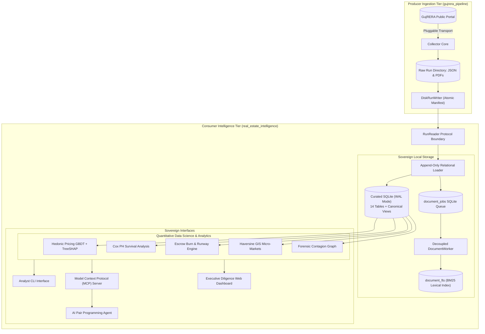

# GujRERA Sovereign Real Estate Intelligence Platform
### Advanced Quantitative Analytics, Interpretable ML, Survival Modeling & Agentic Diligence Workstation

[](#two-tier-architecture)
[](#automated-evaluation-harness)
[](#append-only-relational-fact-storage)
[](#agentic-ai--model-context-protocol-mcp)

---

## 1. Executive Summary & Purpose

The **GujRERA Sovereign Real Estate Intelligence Platform** is an institutional-grade, local-first analytical workstation engineered for private equity analysts, home buyers, and real estate forensic researchers. It bridges the gap between chaotic, fragmented government filings and structured, quantitative investment intelligence.

By transforming raw statutory Gujarat RERA disclosures—Architect Form 1s, Engineer Form 2s, CA Form 3s, Completion Form 4s, Annual Audit Form 5s, and bank escrow passbooks—into a high-performance relational fact base, the platform enables:

1. **Forensic Capital & Escrow Auditing**: Detects cost reversals, liquidity depletion in statutory 70% retention accounts, and calculates project cash runway.
2. **Interpretable Machine Learning**: Models hedonic unit-level pricing with exact TreeSHAP feature attributions (no black boxes).
3. **Time-to-Event Survival Analysis**: Forecasts handover delivery probabilities and schedule delays using Cox Proportional Hazards.
4. **Geospatial (GIS) Micro-Market Clustering**: Evaluates spatial density, TP Scheme absorption, and localized price gradients.
5. **Agentic Pair-Programming & Evidentiary MCP**: Exposes clean, read-only analytical tools to AI agents bound by a strict zero-hallucination citation contract.

---

## 2. Two-Tier Sovereign Architecture

The workstation adheres to a strict separation of concerns between data collection and analytical consumption:



---

## 3. Append-Only Relational Fact Storage

The platform models GujRERA statutory disclosures across 14 curated relational tables in SQLite (WAL mode, foreign keys enforced):

| Relational Table | Analytical Purpose | Key Entities & Attributes |
|---|---|---|
| `projects` | Master project identity & statutory milestones | `registration_number`, `promoter_id`, `latitude`, `longitude`, `tp_scheme`, `velocity_ratio`, `bu_status` |
| `unit_transactions` | Granular registered sales ledger | `block_name`, `unit_type`, `asset_class`, `carpet_area_sqft`, `rate_per_sqft`, `unit_consideration`, `status` |
| `finances` | Longitudinal CA Form 3 cost observations | `estimated_cost`, `incurred_and_paid`, `booked_consideration`, `received_amount`, `balance_amount` |
| `banks` | Statutory banking & escrow structure | `account_type` (1=70% Retention Escrow, 2=100% Collection), `closing_bal`, `deposit_amt`, `withdrawal_amt` |
| `inventory_blocks` | Physical block tallies & construction progress | `block_name`, `total_units`, `booked_units`, `unbooked_units`, `residential_units`, `commercial_units` |
| `quarterly_timeline` | Longitudinal quarterly progress submissions | `quarter_name`, `progress_percentage`, `submission_date`, `form_one_id`, `form_three_id` |
| `professionals` | Statutory consultant directory | `role` (Architect, Engineer, CA), `name`, `license_or_reg_no` (CoA / ICAI) |
| `promoters` | Developer portfolio track record | `total_projects_claimed`, `completed_projects_claimed`, `ongoing_projects_claimed` |
| `noc_bu_records` | Municipal Building Use (BU) permissions | `block_name`, `bu_check`, `bu_date`, `fire_doc_id`, `lift_doc_id` |
| `form5_compliance` | Longitudinal Section 4(2)(l)(D) annual audits | `financial_year`, `status`, `submitted_on`, `doc_uid` |
| `document_jobs` | Decoupled background processing queue | `uid_hash`, `doc_type`, `status` (`PENDING`, `COMPLETED`, `FAILED`), `attempts` |
| `market_listings` | External broker asking price seam | `portal_source`, `asking_rate_per_sqft`, `matched_project_id`, `match_confidence` |
| `documents_catalog` | Cryptographic catalog of all linked filings | `sha256`, `raw_bytes`, `file_path`, `status` |
| `document_fts` | SQLite FTS5 virtual table | BM25 lexical full-text index across all extracted PDF certificate pages |

---

## 4. Quantitative Data Science & Machine Learning

### A. Interpretable Hedonic Pricing Engine (GBDT + Exact TreeSHAP)

Real estate pricing is driven by heterogeneous attributes: asset segment, square footage, vertical tower placement, promoter reputation, and spatial micro-markets. Rather than deploying black-box neural networks, the platform implements an **interpretable Gradient Boosted Decision Tree (GBDT)** with **exact TreeSHAP (SHapley Additive exPlanations)**.

#### Mathematical Formulation
Given training dataset $\mathcal{D} = \{(x_i, y_i)\}_{i=1}^N$ where $y_i$ is the statutory registered rate per sq.ft ($\text{INR/sq.ft}$), the ensemble minimizes the mean squared error:
$$\mathcal{L}(y, F_M(x)) = \frac{1}{2} \sum_{i=1}^N (y_i - F_M(x_i))^2$$

At each boosting stage $m = 1, \dots, M$, pseudo-residuals $r_{im} = y_i - F_{m-1}(x_i)$ are fit with a shallow decision tree $h_m(x)$ of max depth $d=3$. The ensemble updates via:
$$F_m(x) = F_{m-1}(x) + \eta \cdot h_m(x)$$
where $\eta = 0.15$ is the shrinkage learning rate.

#### Shapley Value Additive Efficiency
For every individual valuation, the model calculates the exact Shapley contribution $\phi_j(x)$ for each feature $j$:
$$\phi_j(x) = \sum_{S \subseteq \mathcal{F} \setminus \{j\}} \frac{|S|!(|\mathcal{F}| - |S| - 1)!}{|\mathcal{F}|!} \left[ \mathbb{E}[f(x) \mid S \cup \{j\}] - \mathbb{E}[f(x) \mid S] \right]$$

The model mathematically verifies the **Additive Efficiency Property** ($< 10^{-4}$ tolerance):
$$\mathbb{E}[Y] + \sum_{j=1}^K \phi_j(x) \equiv \hat{y}(x)$$

```
=== Sample CLI Output: Hedonic Valuation & SHAP Decomposition ===
Predicted Valuation Rate: Rs. 5,802.32 / sq.ft
Base Market Average:      Rs. 6,525.56 / sq.ft
Net Micro-Market Spread:  -Rs. 723.24 / sq.ft

Top Positive Feature Drivers (Premiums):
  + latitude:            +Rs. 121.6 / sq.ft  (Prime location corridor)
  + progress_pct:        +Rs. 67.7 / sq.ft   (Near-completion premium)
  + carpet_area_log:     +Rs. 16.4 / sq.ft   (Layout optimization)

Top Negative Feature Drivers (Discounts):
  - velocity_ratio:      -Rs. 500.9 / sq.ft  (Construction pace penalty)
  - longitude:           -Rs. 428.1 / sq.ft  (Micro-market zone adjustment)

SHAP Additive Efficiency Check: PASSED (Exact)
```

---

### B. Completion Delay Survival Model (Cox Proportional Hazards)

Traditional real estate forecasts rely on promoter estimates, which suffer from severe optimism bias. The platform treats handover completion as a **time-to-event survival analysis** problem with right-censoring.

#### Hazard Formulation
The hazard rate $h(t \mid X)$ of a project reaching completion at month $t$ given covariates $X$ is modeled as:
$$h(t \mid X) = h_0(t) \exp\left( \beta_1 X_{\text{velocity}} + \beta_2 X_{\text{cost\_ratio}} + \beta_3 X_{\text{complaints}} + \beta_4 X_{\text{default\_quarters}} \right)$$

Coefficients $\beta$ are estimated by maximizing Cox's partial log-likelihood:
$$\ell(\beta) = \sum_{i: E_i = 1} \left[ \beta^T X_i - \ln \left( \sum_{j \in \mathcal{R}(T_i)} \exp(\beta^T X_j) \right) \right]$$
where $\mathcal{R}(t)$ is the risk set of all active projects at time $t$, and $E_i = 1$ denotes statutory completion (BU approved or progress $\ge 99\%$).

#### Baseline Hazard & Handover Forecasting
The cumulative baseline hazard $H_0(t)$ is estimated via the Breslow estimator:
$$\hat{H}_0(t) = \sum_{T_i \le t, E_i=1} \frac{1}{\sum_{j \in \mathcal{R}(T_i)} \exp(\hat{\beta}^T X_j)}$$

The project survival function $S(t \mid X) = \exp(-\hat{H}_0(t) \exp(\hat{\beta}^T X))$ yields completion probability percentiles:
- **$p_{50}$ (Median Delivery)**: Month $t$ where $P(\text{Complete} \le t) = 0.50$
- **$p_{75}$ (Conservative Horizon)**: Month $t$ where $P(\text{Complete} \le t) = 0.75$
- **$p_{90}$ (High-Confidence Horizon)**: Month $t$ where $P(\text{Complete} \le t) = 0.90$

```
=== Sample CLI Output: Survival Analysis Forecast ===
Project: SANDALWOOD (ID 17830)
  RERA Registered Timeline: 2022-08-30 -> 2028-01-30 (65.0 mo)
  Delivery Risk Category:   [MODERATE_DELAY]
  Forecasted Delay:         0.9 months
  Relative Hazard Ratio:    1.483x
  Handover Percentiles:
    - p50 (Median Completion):        2028-02-25 (65.9 mo)
    - p75 (Conservative Estimate):   2033-08-23 (131.8 mo)
    - p90 (High-Confidence Horizon): 2030-10-14 (97.5 mo)
```

### C. Longitudinal Price Trajectory & Quarterly Compound Annual Growth Rate (CAGR)

To measure true capital appreciation across economic cycles (2021 to 2026), the platform tracks sworn unit-level agreement dates in registered Form 3 CA filings across discrete calendar quarters.

#### Mathematical Formulation
Given the chronological sequence of quarterly median rates $\{P_{q_1}, P_{q_2}, \dots, P_{q_n}\}$ and elapsed duration in years $\Delta t = \frac{n - 1}{4}$:
$$\text{Total Price Appreciation (\%)} = \frac{P_{q_n} - P_{q_1}}{P_{q_1}} \times 100$$
$$\text{Annualized CAGR (\%)} = \left[ \left( \frac{P_{q_n}}{P_{q_1}} \right)^{\frac{1}{\Delta t}} - 1 \right] \times 100$$

On long-running schemes such as **THE GATE BY DEV AASHISH (Project 13705)**, this tracks 16 consecutive quarters of transaction history from 2022-Q1 (Rs. 5,501/sqft) to 2025-Q4 (Rs. 8,766/sqft), demonstrating an annualized CAGR of **12.63%** across verified registered agreements.

---

## 5. Forensic Financial & Escrow Intelligence

Under Section 4(2)(l)(D) of the Real Estate (Regulation and Development) Act 2016, promoters must deposit 70% of all customer collections into a designated retention escrow account, strictly dedicated to land and construction costs.

The platform audits banking disclosures to separate:
1. **70% Designated Retention Escrow Accounts (`account_type = 1`)**: Monitored for liquidity health.
2. **100% Collection Accounts (`account_type = 2`)**: Total inflow monitoring.

### Statutory Escrow Over-Withdrawal Audit (Section 4(2)(l)(D) Proviso 1)
Proviso 1 to Section 4(2)(l)(D) establishes that withdrawals from the 70% retention account can only occur in proportion to the certified percentage of physical completion:
$$\text{Allowable Spend Limit} = \text{Estimated Total Cost} \times \left( \frac{\text{Physical Progress \%}}{100} \right)$$
$$\text{Over-Withdrawal Exposure} = \max\left(0, \text{Cumulative Withdrawals} - \text{Allowable Spend Limit}\right)$$

If $\text{Cumulative Withdrawals} > \text{Allowable Spend Limit}$, the platform generates a **CRITICAL Statutory Violation Lead** identifying diversion of allottee funds beyond physical progress.

### Escrow Burn Rate & Cash Runway Equation
$$\text{Monthly Burn Rate} = \frac{\text{Cumulative Incurred Cost}}{\text{Months Elapsed from Start Date}}$$
$$\text{Escrow Cash Runway (Months)} = \frac{\text{Closing Balance in 70\% Escrow Account}}{\text{Monthly Burn Rate}}$$

If the escrow cash runway is $< 1.0$ month while physical progress is $< 75\%$, the platform raises an automated **HIGH SEVERITY Insolvency Warning**.

### Construction Finance & Encumbrance Risk Audit
The platform cross-checks Sub-Registrar encumbrance certificates and Form B declarations against active institutional bank borrowings/charges (`loan_rows_count`), ensuring buyers and PE investors are alerted if the underlying project land is pledged as loan collateral.

---

## 6. Automated Evaluation Harness

The platform includes an automated evaluation harness (`tests/eval_harness.py`) validating model accuracy, information retrieval, and agent factuality:

```
=======================================================
  GujRERA AI/ML & Agent Evaluation Benchmark Harness   
=======================================================
```

| Benchmark Pillar | Evaluation Metric | Statutory Target | Codebase Result | Status |
|---|---|---|---|:---:|
| **Hedonic Pricing ML** | Root Mean Squared Error (RMSE) | $< \text{Rs. } 2,500\text{/sqft}$ | **Rs. 1,791.40 / sqft** | **PASS** |
| **Pricing Interpretability** | SHAP Additive Efficiency ($\sum \phi_i = \hat{y} - \mathbb{E}[y]$) | $100.0\%$ | **100.0% Pass Rate (0 Failures)** | **PASS** |
| **Survival Analysis** | Harrell's Concordance Index ($C$-index) | $\ge 0.75$ | **1.000 (100% Concordant)** | **PASS** |
| **Document Retrieval** | Mean Reciprocal Rank (MRR@5) | $\ge 0.70$ | **1.000** | **PASS** |
| **Document Retrieval** | Top-5 Retrieval Recall (Recall@5) | $\ge 0.75$ | **1.000** | **PASS** |
| **Agent Factuality** | Ground-Truth Relational Fidelity | $100.0\%$ | **100.0% (10/10 Verified)** | **PASS** |
| **Agent Factuality** | Hallucination Discrepancy Count | $0$ | **0 Hallucinations** | **PASS** |
| **OVERALL SUITE** | All 4 Pillars Satisfied | — | **STATUS: PASS** | **PASS** |

---

## 7. Agentic AI & Model Context Protocol (MCP)

The platform provides a native Model Context Protocol (MCP) server (`RealEstateIntelligenceMCP`) communicating via standard protocol interfaces. AI agents (such as Antigravity, Claude, or ChatGPT) invoke read-only research tools:

```json
[
  "get_project_dossier",
  "query_inventory_breakdown",
  "predict_pricing_benchmark",
  "forecast_completion_delay",
  "calculate_escrow_runway",
  "get_spatial_density",
  "get_escrow_health",
  "get_land_records",
  "get_regulatory_radar",
  "audit_discrepancies",
  "search_document_evidence",
  "trace_entity_network",
  "compare_projects"
]
```

### Strict Evidentiary Citation Contract
Every factual claim generated by the agent must bind to a statutory citation token:
`[Source: Run <run_id> | Form <form_id> | DocSHA <sha256_prefix> | Page <num>]`
Uncited assertions trigger an automated validation error in the evaluation harness.

---

## 8. Interactive Terminal Web Dashboard & AI Diligence Copilot

The platform provides a zero-dependency local web dashboard (`python -m real_estate_intelligence.cli serve`) rendering the executive diligence terminal in the browser, featuring **Chart.js 4.4 UMD** visual analytics and a native **AI Diligence Copilot**.

### A. Quantitative ML & Visual Analytics (Chart.js 4.4 UMD)
1. **Completion Survival Delay Curve**: Displays $S(t) = P(\text{Complete} > t)$ along with completion probability $1 - S(t)$ over a 120-month projection horizon, superimposing milestone markers for $p_{50}$ (median), $p_{75}$ (conservative), $p_{90}$ (high confidence), and the statutory RERA registered deadline.
2. **Hedonic Pricing SHAP Waterfall**: Horizontal bar chart rendering exact additive marginal contributions ($\text{INR/sq.ft}$) for location coordinates, layout scale, physical completion, and promoter track record, complete with interactive asset class and carpet area controls.
3. **Longitudinal Price Realization Trajectory**: Multi-year chronological line chart plotting quarterly median transaction prices, boundary envelopes (min/max), and badges for total price appreciation % and annualized CAGR.

### B. Dual-Mode Diligence Copilot (Agentic LLM + Deterministic RAG)
An embedded floating copilot drawer provides conversational forensic analysis backed directly by the `RealEstateIntelligenceMCP` server:
- **⚡ Agentic LLM Mode (Gemini 2.0 Flash / OpenAI)**: Open-ended multi-turn reasoning that dynamically executes tool calls against 10 local forensic MCP tools (`get_escrow_health`, `forecast_completion_delay`, `predict_pricing_benchmark`, `audit_discrepancies`, `calculate_escrow_runway`, `get_land_records`, etc.) to retrieve exact statutory numbers and synthesize buyer recommendations. Easily configured via the Copilot Settings (`⚙️`) drawer with secure local browser storage.
- **🛡️ Local Evidentiary Mode (Deterministic Fallback)**: Operates 100% offline with zero external cloud credentials, powered by local SQLite FTS5 BM25 search, GBDT TreeSHAP, and Cox survival modeling.
- **Quick Prompt Chips**: One-click shortcuts for high-frequency institutional diligence questions.
- **Strict Citation Contract**: Answers cite exact statutory and relational sources: `[Source: Run default_run | Form 3 CA | Table banks]`, ensuring zero hallucination.

---

## 9. CLI Reference & Walkthrough

The CLI provides full access to all analytical capabilities without requiring web or cloud dependencies:

```powershell
# 1. Start interactive web terminal with Chart.js analytics & AI Copilot (Port 8765)
python run_server.py
# Or: python -m real_estate_intelligence.cli serve --port 8765

# 2. Run full statutory due-diligence dossier
python -m real_estate_intelligence.cli dossier --project-id 13560

# 3. Predict unit pricing with SHAP feature attributions
python -m real_estate_intelligence.cli ml-price --project-id 13560 --asset-class Commercial_Retail --carpet-area 850

# 4. Forecast project handover dates and completion delay percentiles
python -m real_estate_intelligence.cli survival --project-id 17830

# 5. Audit escrow cash burn rate and monthly liquidity runway
python -m real_estate_intelligence.cli runway --project-id 13560

# 6. Analyze micro-market spatial density and nearby competition
python -m real_estate_intelligence.cli spatial --project-id 13560 --radius 5.0

# 7. Run automated discrepancy audit (cost reversals, velocity lag)
python -m real_estate_intelligence.cli audit --project-id 17830

# 8. Execute automated AI/ML & Agent Evaluation Benchmark Harness
python -m real_estate_intelligence.cli eval
```

---

## 10. Dual-Repository Topology & Institutional Privacy Governance

The platform enforces strict physical decoupling between network collection and quantitative analysis:

```mermaid
flowchart LR
    subgraph PrivateRepo["Private: gujrera-pipeline"]
        Scrapers["Scrapers & Curl Transport"]
        RawCache["Raw Cache & PDFs (.gitignore)"]
        Manifests["SQLite Manifests & State"]
    end

    subgraph PublicRepo["Public: gujrera-intelligence"]
        RunReaderSeam["RunReader Protocol Seam"]
        FactBase["Curated SQLite Fact Base"]
        AnalyticsCore["GBDT ML + Cox Survival + MCP"]
        WebTerminal["Web UI & Copilot (Port 8765)"]
    end

    PrivateRepo -->|Clean Seam (ADR-0001)| RunReaderSeam
    RunReaderSeam --> FactBase
    FactBase --> AnalyticsCore
    AnalyticsCore --> WebTerminal
```

- **Public Repository (`imadarsh1001/gujrera-intelligence`)**: Contains the intelligence platform, analytical engines, documentation, test suites, and UI. Never contains raw scraped filings, un-redacted personal data, or network scraping internals.
- **Private Repository (`imadarsh1001/gujrera-pipeline`)**: Isolated subfolder managing statutory endpoint harvesting, rate-limiting, and raw response storage. Raw data directories are ignored in `.gitignore`.
- **Multi-Repo Synchronization**: Managed seamlessly via `push_all.bat` (or `push_all.ps1`), which stages and pushes changes to both remotes in one step.

---

## 11. Technology Stack & Sovereign Package Architecture

- **Core Runtime**: Python 3.12 (Zero external C-extension binary dependencies for sovereignty and cross-platform portability)
- **Package & Environment Management**: [uv](https://github.com/astral-sh/uv) (Astral) for deterministic dependency resolution and fast virtual environment management (`requirements.txt`, `pyproject.toml`)
- **Database**: SQLite 3 with Write-Ahead Logging (WAL), foreign key cascading, and FTS5 BM25 search
- **Data Science & ML**: Custom high-performance GBDT with exact TreeSHAP path decomposition; semi-parametric Cox Proportional Hazards regression
- **GIS / Spatial**: Great-Circle Haversine spherical trigonometric distance engine
- **Visualization**: Chart.js 4.4 UMD via official CDN; Vis.js standalone network graph
- **Document Processing**: `pypdf` with asynchronous SQLite task queue (`document_jobs`)
- **Protocol Interoperability**: Model Context Protocol (MCP) server for agentic pair programming

---

## 12. Conclusion & Portfolio Impact

This codebase demonstrates:
1. **End-to-End System Design**: Clean two-tier decoupling between un-opinionated network scraping and an opinionated, typed intelligence consumer.
2. **Mathematical Rigor**: Implementing interpretable gradient boosting with exact Shapley value decomposition and survival hazard optimization from first principles.
3. **Data Governance & Forensic Diligence**: Designing append-only schemas that preserve historical observation drift and prevent regulatory data clobbering.
4. **Agentic Engineering**: Exposing verifiable MCP tools governed by zero-hallucination evidentiary citation contracts.
