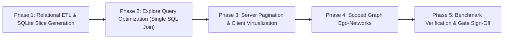

# RFC-0001: Data Lake Ingestion, Query Engine Optimization & UI Virtualization

* **Status:** Proposed / Draft
* **Author:** Elephant / Assistant
* **Date:** 2026-11-17
* **Target Subsystems:** `db.loader`, `ui.server`, `ui/static/index.html`, `scripts/`
* **Related ADRs:** [ADR-0001](../adr/0001-run-reader-ingestion-seam.md), [ADR-0002](../adr/0002-columnar-parquet-data-lake-and-document-manifest.md)

---

## 1. Executive Summary

The private collection pipeline (`gujrera-pipeline`) holds an immutable Columnar Parquet Data Lake comprising **58,741 quarterly Form 3 filings across 17,632 registered projects** (99.99% statewide coverage in Gujarat). The public analytical platform (`real_estate_intelligence`), however, currently operates over a curated 9-project seed database (`intelligence.sqlite`).

Expanding the analytical platform to ingest district-level slices (~1,500 projects for Ahmedabad) or the statewide registry cannot be achieved by simple table insertion. As identified during the EGM Goldfish Review (`docs/reviews/intermediate_zoom_out_report.md` and `docs/reviews/implementation_readiness_report.md`), five critical architectural barriers prevent direct lake ingestion:

1. **Host Security Architecture (WDAC):** Windows Defender Application Control (WDAC) on the host environment blocks compiled third-party C-extensions (`_duckdb.pyd` and `_fs.pyd` from PyArrow).
2. **Schema Incompatibility & NOT NULL Constraints:** Form 3 filings are Chartered Accountant expenditure certificates. They contain cost entries and unit totals, but lack master project registration fields (`registration_number`, `promoter_name`, `promoter_id`), causing immediate SQLite `NOT NULL` constraint crashes on `projects`.
3. **The $O(N)$ N+1 Query Cascade:** `ui/server.py:_explore_rows` executes four child SQL queries per project in a Python loop. At 1,500 projects, every single `/api/explore` request executes **6,001 synchronous database queries**, making the sub-50ms latency target physically impossible.
4. **Graph Canvas Saturation:** `/api/graph` dumps all database nodes into the browser. Loading 1,500 projects will inject ~12,000 nodes and ~25,000 edges into an unclustered Vis.js canvas, freezing the client tab.
5. **Evaluation Benchmark Invalidation:** `tests/eval_harness.py` evaluates delay forecasting and pricing models across all database records. Ingesting incomplete or unverified filing slices corrupts the Harrell C-index and pricing RMSE thresholds.

This RFC defines the architectural blueprint to resolve these constraints through pure-Python/out-of-band extraction, relational schema joining, dedicated database isolation, SQL aggregation refactoring, server-side pagination, and ego-network graph scoping.

---

## 2. Technical Architecture & Design Decisions

### 2.1 Part A: WDAC-Safe Extraction & The Ingestion Seam
* **Problem:** `import duckdb` and `import pyarrow` abort on the host runtime with `ImportError: DLL load failed: An Application Control policy has blocked this file`.
* **Decision:** Decouple extraction from host C-extensions by adopting one of two supported pathways:
  * **Pathway 1 (Recommended — Out-of-Band Generation):** Ingestion runs as an automated export task inside the private `gujrera-pipeline` repo (or a non-WDAC build worker), converting Parquet partitions into an immutable, portable SQLite artifact (`gujrera_pipeline/data/runs/<run_id>/ahmedabad_slice.sqlite`). The public platform consumes this generated SQLite database directly via the standard library `sqlite3` driver.
  * **Pathway 2 (Pure-Python Decoding):** Use pure-Python Parquet parsers (`fastparquet` without C-extensions or `snappy`/pure decompression) strictly if in-process Python ingestion is required.

### 2.2 Part B: Relational Multi-Table Schema Joining
* **Problem:** Form 3 quarterly filings cannot populate `projects` due to missing `NOT NULL` columns.
* **Decision:** All district or statewide ingestions must execute a relational join across three columnar assets in `gujrera_pipeline/data/` before inserting into SQLite:
  1. `data/indexes/all_projects_*.parquet` $\to$ provides master `project_id`, `name`, `registration_number`, `promoter_id`, `promoter_name`, `district`, `project_type`, `start_date`, and `completion_date`.
  2. `data/filings/*/*.parquet` $\to$ provides quarterly expenditure timeline (`incurred_cost_inr`, `estimated_cost_inr`, `received_amount`, `balance_amount`) and unit totals.
  3. `data/samples/*/meta.zip` (where available) $\to$ provides granular unit transactions, bank account numbers, and professional team records.

### 2.3 Part C: Database & Benchmark Isolation
* **Problem:** Ingesting 1,500 projects into `real_estate_intelligence/data/intelligence.sqlite` mutates the 9-project reference dataset and breaks `run_server.py eval`.
* **Decision:**
  * Preserve `data/intelligence.sqlite` strictly as the pristine 9-project reference fixture for unit tests and AI/ML evaluation benchmarks.
  * Ingest district slices into dedicated named database artifacts:
    - `data/ahmedabad_benchmark.sqlite` (~1,500 projects)
    - `data/statewide_registry.sqlite` (17,632 projects)
  * The server launcher accepts a `--db` parameter:
    ```bash
    python run_server.py serve --db data/ahmedabad_benchmark.sqlite --port 8765
    ```

### 2.4 Part D: Query Engine Optimization ($O(N) \to O(1)$ in `_explore_rows`)
* **Problem:** `ui/server.py:_explore_rows` loops through each project and issues 4 child queries per row.
* **Decision:** Replace the Python loop with a **single SQL query** utilizing `LEFT JOIN` and subquery aggregations:
  ```sql
  SELECT 
      p.project_id,
      p.name,
      p.district,
      p.completion_date,
      p.engg_score_pct,
      p.latest_form_one_progress_pct,
      p.project_type,
      p.has_complaints,
      p.has_extensions,
      COALESCE(ut.min_price_booked, 0) AS min_price_booked,
      COALESCE(ut.min_rate_sqft_booked, 0) AS min_rate_sqft_booked,
      f.latest_filing_date,
      CASE 
          WHEN f.latest_filing_date IS NULL THEN NULL 
          ELSE CAST((julianday('now') - julianday(f.latest_filing_date)) AS INTEGER) 
      END AS days_since_latest_filing,
      COALESCE(app.ext_count, 0) AS ext_count,
      COALESCE(f.filings_count, 0) AS filings_count
  FROM projects p
  LEFT JOIN (
      SELECT project_id, MIN(unit_consideration) AS min_price_booked, MIN(rate_per_sqft) AS min_rate_sqft_booked
      FROM unit_transactions
      WHERE status = 'BOOKED'
      GROUP BY project_id
  ) ut ON p.project_id = ut.project_id
  LEFT JOIN (
      SELECT project_id, MAX(filing_date) AS latest_filing_date, COUNT(*) AS filings_count
      FROM finances
      WHERE filing_date IS NOT NULL
      GROUP BY project_id
  ) f ON p.project_id = f.project_id
  LEFT JOIN (
      SELECT project_id, COUNT(*) AS ext_count
      FROM applications
      WHERE application_type = 'Extension'
      GROUP BY project_id
  ) app ON p.project_id = app.project_id
  ORDER BY p.project_id ASC;
  ```
  *Latency Impact:* Reduces execution from 6,001 round-trips to **1 single index-backed query**, executing in $<15\text{ ms}$ for 1,500 rows.

### 2.5 Part E: REST & UI Pagination Contract
* **Problem:** Transmitting 1,500 rows in a single unpaginated JSON array causes network bloat (~3 MB payload) and client DOM lag.
* **Decision:**
  * Add query parameters to `/api/explore`:
    * `limit` (default: 50, max: 200)
    * `offset` (default: 0)
    * `sort_by` (`name`, `district`, `completion_date`, `progress_pct`, `min_price_booked`, `min_rate_sqft_booked`, `days_since_latest_filing`)
    * `sort_order` (`asc`, `desc`)
  * Response Envelope:
    ```json
    {
      "total_count": 1542,
      "filtered_count": 412,
      "limit": 50,
      "offset": 0,
      "items": [...]
    }
    ```
  * Frontend: Implement virtualized row rendering or pagination controls (`Previous`, `Page 1 of 9`, `Next`) in `ui/static/index.html`.

### 2.6 Part F: Graph Scoping & Ego-Networks (`/api/graph`)
* **Problem:** Dumping all nodes and edges into Vis.js locks the browser thread under large graph topologies.
* **Decision:**
  * Update `/api/graph` to accept scoping parameters:
    * `/api/graph?project_id=13560&depth=2` $\to$ Returns the 1st and 2nd degree ego-network of the target project (promoters, sister projects, verified architects/engineers, lender banks).
    * `/api/graph?district=Ahmedabad&min_contagion=2` $\to$ Returns shared-entity clusters where professionals link 2 or more projects.
  * Node Cap: Enforce a hard ceiling of `MAX_NODES = 250` per graph response, with clustering for promoter conglomerates.

---

## 3. Implementation Phasing & Milestones



### Phase 1: Relational ETL & SQLite Slice Generation
1. Implement `scripts/generate_district_sqlite.py` inside `gujrera_pipeline` (out-of-band).
2. Perform DuckDB/PyArrow join between `all_projects.parquet` and `form3_ahmedabad.parquet`.
3. Emit `real_estate_intelligence/data/ahmedabad_benchmark.sqlite` adhering to `db.database.init_schema`.

### Phase 2: Explore Query Optimization
1. Refactor `ui/server.py:_explore_rows` into the single aggregated SQL query.
2. Add covering indexes in SQLite:
   ```sql
   CREATE INDEX IF NOT EXISTS idx_ut_proj_status ON unit_transactions(project_id, status, unit_consideration, rate_per_sqft);
   CREATE INDEX IF NOT EXISTS idx_fin_proj_date ON finances(project_id, filing_date);
   CREATE INDEX IF NOT EXISTS idx_app_proj_type ON applications(project_id, application_type);
   ```

### Phase 3: Server Pagination & Client Virtualization
1. Update `/api/explore` handler in `ui/server.py` to parse `limit`, `offset`, and filters.
2. Add pagination bar to `ui/static/index.html` below `#exploreBody`.

### Phase 4: Scoped Graph Ego-Networks
1. Update `graph/network.py` with `get_ego_network(project_id, depth=2)`.
2. Update `/api/graph` in `ui/server.py` to require `project_id` or `cluster_id`.

### Phase 5: Benchmark Verification & Gate Sign-Off
1. Execute `scripts/verify_server.py` against `ahmedabad_benchmark.sqlite`.
2. Measure response latencies:
   - `/api/explore?limit=50`: $< 25\text{ ms}$
   - `/api/project/13560`: $< 10\text{ ms}$
   - `/api/graph?project_id=13560`: $< 15\text{ ms}$
   - `/api/search?query=encumbrance`: $< 50\text{ ms}$

---

## 4. Invariants & Security Considerations

1. **Dual-Repo Sovereignty:** The public `real_estate_intelligence` repository remains free of raw unredacted scraping artifacts. Raw data extraction occurs strictly inside the private pipeline boundary.
2. **Benchmark Isolation:** The 9-project reference database (`intelligence.sqlite`) remains immutable and version-controlled, guaranteeing reproducibility for `eval_harness.py`.
3. **Read-Only Server Invariant:** UI connections continue to query in read-only mode, with writes restricted exclusively to offline ETL scripts.
4. **Privacy Redaction:** All joined tables in generated SQLite slices exclude personal Aadhaar, PAN, and KYC columns.
